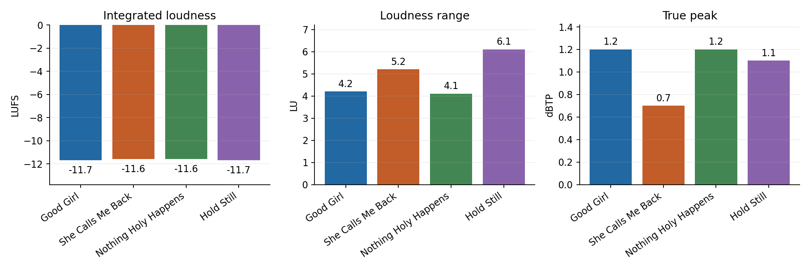
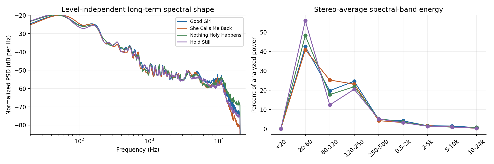
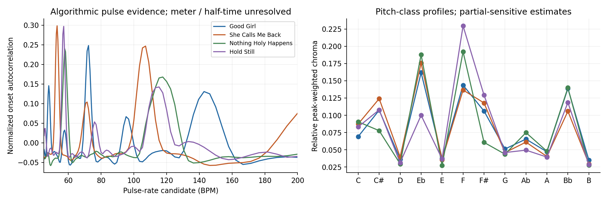
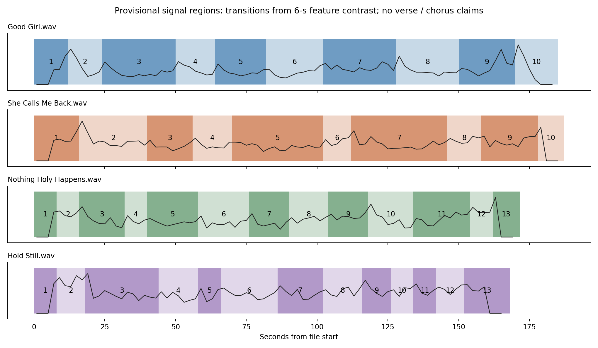
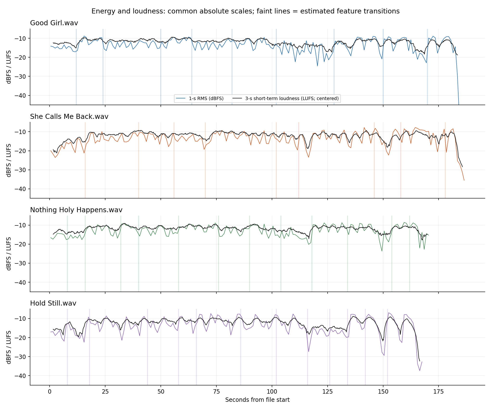
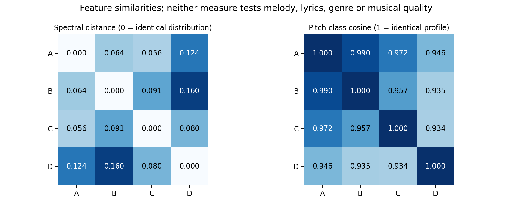
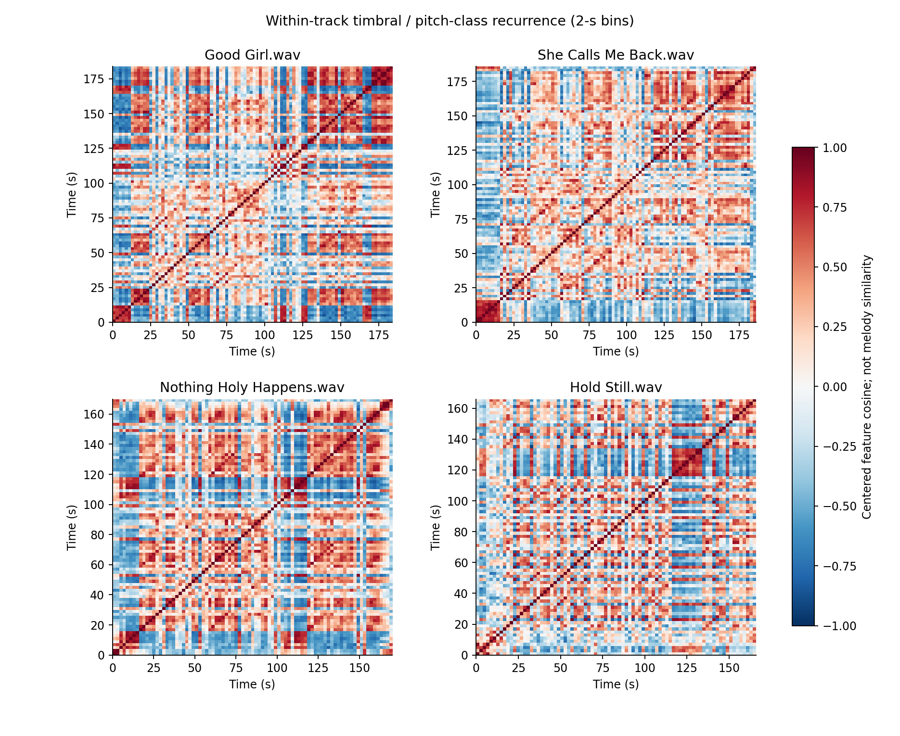
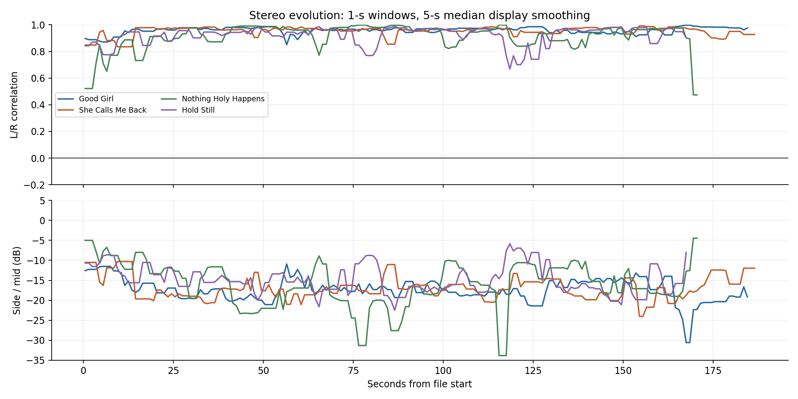

# Four-song audio audit
Blind signal analysis and musical identity assessment | 12 October 2026

## Scope and evidence contract
The recordings were analyzed from their audio samples without using saved memories, earlier conversations, artist preferences, lyric documents or intended genre. Filenames identify files only. The order A-B-C-D below is attachment order, not a confirmed album running order. The stated Suno provenance was not used to infer audible characteristics.

**Measured [M]** means calculated directly from decoded audio, including standardized loudness measurements and explicitly defined signal descriptors. **Estimated [E]** means an algorithmic inference about pulse, pitch or section boundaries; scores are not confidence probabilities. **Interpretive [I]** means a bounded assessment of what those measurements could imply musically. No direct perceptual observations are claimed.

**Capability limitation:** Direct audio listening was not performed. No local learned audio-perception or source-separation model was available, and no remote audio-perception service was invoked. Reliable lyric transcription, vocal melody extraction and instrument recognition were not performed. NumPy, SciPy, Matplotlib, FFmpeg and FFprobe were available. SoundFile, librosa, pyloudnorm, Torch, torchaudio and Demucs were not installed and were not used. This is a comprehensive signal-based audit with provisional musical analysis, not a completed critical-listening review. Vocal consistency, genre, groove feel, intelligibility, exact chords, singer range, emotion, instrument identities and audible generative artifacts cannot be responsibly established here.

The originals were read only. Both complete decoding and SHA-256 checks were used; no edited audio, new music, lyrics or generation prompts were produced.

## 1. Executive findings
1. **[M] Loudness is unusually tightly matched within this set.** Integrated loudness spans only 0.13 LU in the scanner metadata, while LRA spans approximately 4.1-6.1 LU. Similar overall loudness therefore conceals appreciable differences in section dynamics.
2. **[M] All four files use essentially all available sample headroom.** They contain PCM-rail samples and reconstructed peaks above 0 dBTP. Independent oversampling corroborates peaks around +0.71 to +1.16 dB. This is the clearest shared technical review item; audible clipping has not been established.
3. **[M/I] The shared signal signature is strong low-frequency weight with a center-focused stereo image.** About 87.0-89.3% of long-term stereo-average spectral power is below 250 Hz. Broadband L/R correlation is 0.899-0.950; low-frequency correlation below 120 Hz is about 0.975-0.977. These characterize the files, not a specific instrument or genre.
4. **[E/M] Rhythm and dynamics supply real differentiation.** The main pulse families are approximately 72/144, 53/106, 58/117 and 57/115 BPM. Hold Still has the largest LRA, the largest sub-bass share and a middle third stronger than its final third. A universal steadily expanding finale is not supported.
5. **[M/E] A late-middle reduction followed by renewed energy recurs across all four, but the complete energy curves are not close copies.** Recurrent timbral/pitch-class regions are detectable within each song. Their musical function remains unconfirmed.
6. **[M] Endings deserve selective attention.** Good Girl and Hold Still finish near silence. She Calls Me Back and Nothing Holy Happens end at nonzero sample values, with appreciable signal in their last milliseconds. This supports checking for a tail cutoff or endpoint click, not asserting that one is audible.
7. **[E] Pitch-class profiles overlap strongly, but key assignments are unstable.** Frequency-band and extraction-method checks change the leading key. Similar pitch inventories are plausible; identical harmony or melodies are not demonstrated.

## 2. File access and principal measurements

| ID / filename | Duration | Sample rate | Channels | PCM depth | Decode |
| --- | --- | --- | --- | --- | --- |
| A / Good Girl.wav | 3:05 | 48,000 Hz | 2 | 24 bit | Complete |
| B / She Calls Me Back.wav | 3:07.2 | 48,000 Hz | 2 | 24 bit | Complete |
| C / Nothing Holy Happens.wav | 2:51.6 | 48,000 Hz | 2 | 24 bit | Complete |
| D / Hold Still.wav | 2:48 | 48,000 Hz | 2 | 24 bit | Complete |

**[M] Completeness:** FFprobe header durations match decoded sample counts to better than one sample; all samples are finite and FFmpeg scans returned successfully. This confirms file/decoder integrity, not the artistic completeness of any ending. Combined duration is 11:51.8.

| Measured feature | A | B | C | D |
| --- | --- | --- | --- | --- |
| Integrated loudness (LUFS) | -11.68 | -11.61 | -11.60 | -11.72 |
| Loudness range (LU) | 4.23 | 5.17 | 4.07 | 6.06 |
| Sample peak (dBFS) | 0.00 | 0.00 | 0.00 | 0.00 |
| True peak, EBU scanner (dBTP) | +1.2 | +0.7 | +1.2 | +1.1 |
| True peak, 192-kHz check (dBTP) | +1.15 | +0.71 | +1.15 | +1.06 |
| Full-file stereo RMS (dBFS) | -12.63 | -12.53 | -12.16 | -12.20 |
| Full-file crest factor (dB) | 12.63 | 12.53 | 12.16 | 12.20 |
| Short-term P10 / P90 (LUFS) | -14.3 / -10.3 | -14.9 / -10.2 | -14.0 / -10.3 | -15.7 / -9.9 |
| PCM-rail samples, both channels | 20 | 11 | 16 | 44 |
| L/R correlation | 0.950 | 0.941 | 0.899 | 0.918 |
| Side / mid power (dB) | -15.95 | -15.16 | -12.73 | -13.71 |
| Side share of stereo power (%) | 2.48 | 2.96 | 5.06 | 4.09 |
| Mean-mono power change (dB) | -0.109 | -0.130 | -0.226 | -0.181 |
| Below-120-Hz L/R correlation | 0.975 | 0.975 | 0.977 | 0.976 |
| Below-120-Hz side / mid (dB) | -19.05 | -19.05 | -19.30 | -19.19 |
| Power-weighted centroid (Hz) | 384 | 299 | 352 | 279 |
| Median magnitude centroid (Hz) | 2827 | 1832 | 2893 | 2233 |
| First 1-s RMS (dBFS) | -14.1 | -20.0 | -16.6 | -17.1 |
| Last 50-ms RMS (dBFS) | -108.3 | -31.4 | -42.4 | -105.5 |

**Reading the table:** dBFS references digital full scale; dBTP references oversampled reconstructed peaks. RMS averages both channel powers. The crest factor is full-file sample peak minus full-file RMS; it is not the same quantity as LRA or a short-window dynamic-range score. Mono uses (L+R)/2 and compares its power with mean stereo channel power; this is a defined signal comparison, not a calibrated perceived loudness loss. P10/P90 use valid 3-s windows above -45 LUFS after startup and are not standardized gated LRA. LRA and true peak are implementation-specific measurements, not guarantees of audibility or exact analog reconstruction.

### Spectral-band comparison [M]

| Band / percent of power | A | B | C | D |
| --- | --- | --- | --- | --- |
| Below 20 Hz | 0.06% | 0.04% | 0.07% | 0.06% |
| 20-60 Hz | 42.50% | 40.85% | 48.22% | 55.88% |
| 60-120 Hz | 19.78% | 25.28% | 17.74% | 12.40% |
| 120-250 Hz | 24.63% | 23.14% | 21.81% | 20.49% |
| 250-500 Hz | 4.96% | 4.30% | 5.23% | 5.10% |
| 500 Hz-2 kHz | 4.19% | 3.31% | 3.57% | 3.29% |
| 2-5 kHz | 1.65% | 1.70% | 1.52% | 1.37% |
| 5-10 kHz | 1.53% | 1.00% | 0.94% | 1.02% |
| 10-24 kHz | 0.72% | 0.38% | 0.89% | 0.39% |

Band percentages derive from stereo-average Welch power spectral density across each complete recording. Band boundaries use FFT-bin assignment; percentages depend on the stated method. A presence-band percentage is not vocal level, and a low upper-mid percentage is not proof of masked vocals. The low power centroid and much higher magnitude centroid are compatible: squared amplitude strongly weights low-frequency energy, while magnitude weighting gives weaker high-frequency bins more influence. Neither establishes perceived brightness by itself.

## 3. Musical feature estimates and analytical limits

| Track | Pulse family [E] | Onset ACF score | Primary key model [E] | Confidence / limitation |
| --- | --- | --- | --- | --- |
| A | 72 / 144 BPM | 0.248 | Bb minor / Eb minor | Pulse family: moderate; key: low |
| B | 53 / 106 BPM | 0.298 | Eb minor / Bb minor | Pulse family: moderate; key: low |
| C | 58 / 117 BPM | 0.240 | Eb major / Bb major | Pulse family: moderate; mode: low |
| D | 57 / 115 BPM | 0.297 | Bb minor / F minor | Pulse family: moderate; key: low |

**Tempo:** Candidate rates come from positive spectral-flux onset autocorrelation. Slow and fast peaks need not be exact doubles because different accent patterns and the 10-ms lag grid influence the maxima. Parabolic interpolation gives leading slow rates 72.02, 53.03, 57.88 and 56.99 BPM, but these extra digits are algorithm output, not warranted tempo precision. Practical reporting is rounded. Local 20-s windows generally retain the same families; small shifts do not establish an intentional tempo ramp. No confirmed beat grid, meter, subdivision, swing, syncopation score or drum complexity is available. ACF strength describes periodic onset evidence, not perceived groove or energy.

**Tonality:** A harmonic-mask, spectrally whitened peak-chroma method and Krumhansl-style major/minor profile correlations were used as exploratory estimates. Chroma collapses octaves and includes harmonic partials. It cannot identify melody, root motion or exact chords. For A, the primary method favors Bb minor but the long-term peak method favors Eb minor; B favors Eb minor overall but its 200-2000-Hz band favors Bb minor; C favors Eb major overall but its higher band favors Bb minor; D favors Bb minor overall, with C# major (Db major) leading the low-band alternative and A minor leading the higher band. These conflicts prevent confirmed key/mode assignments. Changing local leading keys does not prove modulation. Harmonic density, exact progressions, vocal register shifts and melodic motifs remain unverified.

**Structure:** Boundaries are estimated from contrasting adjacent 6-s means of spectral-shape and pitch-class features, sampled in 2-s bins. Reported positions are approximate, usually at least +/- 3 s and sometimes wider. Peaks are candidates for listening, not definitive sections. The detector caps its output at 12 boundaries per file, so boundary counts cannot rank structural complexity. The maps below use neutral signal-region descriptions. Intro/outro names are provisional; verse, pre-chorus, chorus, bridge, vocal gap and instrumental break labels are unavailable without listening or lyrics.

## 4. Individual recording reports

### A - Good Girl.wav

**Musical identity [M/E/I]:** A is the pulse-rate outlier at approximately 72/144 BPM and the most center-focused broadband recording. Its two longer relative energy reductions divide the latter portion, so its measurable identity is rhythmic periodicity plus repeated withdrawal and return, rather than a continuous ascent. No genre or emotional identity is assigned.

**Signature characteristics:** It has the greatest 5-10-kHz power share (1.53%) and a narrower overall side/mid balance (-15.95 dB) than the others. The late-middle trough is substantial, yet its earliest strong material contains the highest 1-s RMS. This challenges an assumption that the strongest moment must be the finale.

**Production:** Integrated loudness is -11.68 LUFS, LRA 4.23 LU and full-file crest factor 12.63 dB. The signal is low-frequency weighted and strongly correlated between channels. A negative correlation window occurs only in the near-silent final second (-56.4 dBFS RMS), so treating that as a meaningful mono failure would be misleading.

**Evidence-supported strengths [I]:** Distinct pulse family and extended late contrast provide differentiating features. The ending approaches silence, with no persistent full-scale flat run longer than one sample found.

**Potential weaknesses:** Peak headroom deserves investigation; the largest reconstructed peak occurs around 1:34.0. The quieter late-middle region might provide useful contrast or feel prolonged; numerical data cannot decide. The high low-frequency share is not itself a mixing defect.

**Arrangement and structure [E]:** The following map describes signal development. It does not identify actual source entrances, vocal sections, instrumentation, reverb, doubling or arrangement density. Boundaries are provisional.

| Region | Timestamp | Evidence / neutral role |
| --- | --- | --- |
| 1 | 0:00-0:12 | Lower-energy opening; possible intro role unverified. |
| 2 | 0:12-0:24 | Raised-energy region; 15-16 s contains the strongest 1-s RMS. |
| 3 | 0:24-0:50 | Fluctuating energy with stable pulse-family evidence. |
| 4 | 0:50-1:04 | Renewed stronger region; 50-60 s RMS -11.5 dBFS. |
| 5 | 1:04-1:22 | Lower-energy interval, followed by return toward stronger levels. |
| 6 | 1:22-1:42 | Sustained stronger region with short-term fluctuations. |
| 7 | 1:42-2:08 | Extended relative energy reduction; lowest interior 1-s RMS at 120-121 s. |
| 8 | 2:08-2:30 | Recovery; recurrent feature region around 138 s. |
| 9 | 2:30-2:50 | Strong at 150-160 s, then a clear 160-170 s reduction. |
| 10 | 2:50-3:05 | Renewed energy at 170-180 s, then ending toward near silence. |

**Repeated-region candidates [E]:** 0:54-1:06 resembles 2:18-2:30 (centered feature cosine 0.763); 0:24-0:36 resembles 1:04-1:16 (centered feature cosine 0.752). Similarity is method-relative and can reflect shared texture without matching melodic content.

**Notable technical moments [M]:** Maximum 4x oversampled peak at 1:34.0, channel 2, approximately +1.15 dB. Strongest 1-s RMS is the interval 0:15-0:16, -8.8 dBFS. Lowest interior 1-s RMS (excluding first/last 5 complete seconds) is 2:00-2:01, -24.6 dBFS.

**Uncertainty:** Human listening is needed to name the structural functions, identify instruments and vocal treatments, judge transition smoothness, and determine whether the highlighted peak, mono or ending behavior is audible or artistically intentional. None of these recordings receives an arbitrary quality score.

### B - She Calls Me Back.wav

**Musical identity [M/E/I]:** B has approximately 53/106-BPM periodicity, the quietest first 10-s block, and the clearest progressive increase in mean energy across thirds. Its first-to-last-third increase is about 2.0 dB. This distinguishes its measured development from A's nearly flat thirds and D's middle-heavy trajectory.

**Signature characteristics:** It has the largest 60-120-Hz power share (25.28%) and the lowest 10-24-kHz share (0.38%). Its 160-170 s block averages -9.5 dBFS, stronger than the opening block's -18.3 dBFS, without implying a particular instrumental buildup or emotional arc.

**Production:** Integrated loudness is -11.61 LUFS, LRA 5.17 LU and true peak about +0.71 dBTP. Its overall stereo image is strongly centered, yet a 1-s window at 1:25-1:26 has much lower correlation. That local exception disappears in whole-file averages.

**Evidence-supported strengths [I]:** A comparatively low-level entry and stronger later blocks provide a clear large-scale contrast. The lower reconstructed peak relative to A/C/D is a factual difference, although it still exceeds full scale.

**Potential weaknesses:** The ending retains signal and ends at a nonzero sample. Check the final second for an audible truncation or click. The short stereo change around 1:25 is worth a mono comparison; no disappearing vocal or instrument has been established.

**Arrangement and structure [E]:** The following map describes signal development. It does not identify actual source entrances, vocal sections, instrumentation, reverb, doubling or arrangement density. Boundaries are provisional.

| Region | Timestamp | Evidence / neutral role |
| --- | --- | --- |
| 1 | 0:00-0:16 | Quietest opening block in this set, with progressive energy growth. |
| 2 | 0:16-0:40 | Step into stronger material and continued energy increase. |
| 3 | 0:40-0:56 | Stronger region followed by relative easing. |
| 4 | 0:56-1:10 | Lower-energy material; feature recurrence with the earlier region. |
| 5 | 1:10-1:42 | Renewed stronger energy around 70-90 s, then easing. |
| 6 | 1:42-1:52 | Relative level reduction leading toward a short trough. |
| 7 | 1:52-2:26 | Brief deep dip around 116 s, then recovery and high local peaks. |
| 8 | 2:26-2:38 | Drop-and-recovery behavior; feature recurrence around 152 s. |
| 9 | 2:38-2:58 | 160-170 s is the strongest 10-s block (-9.5 dBFS). |
| 10 | 2:58-3:07.2 | Ending level reduction; nonzero endpoint and residual final signal. |

**Repeated-region candidates [E]:** 0:34-0:46 resembles 1:10-1:22 (centered feature cosine 0.707); 1:56-2:08 resembles 2:32-2:44 (centered feature cosine 0.653). Similarity is method-relative and can reflect shared texture without matching melodic content.

**Notable technical moments [M]:** Maximum 4x oversampled peak at 1:16.2, channel 2, approximately +0.71 dB. Strongest 1-s RMS is the interval 2:21-2:22, -7.8 dBFS. Lowest interior 1-s RMS (excluding first/last 5 complete seconds) is 1:56-1:57, -23.5 dBFS.

**Uncertainty:** Human listening is needed to name the structural functions, identify instruments and vocal treatments, judge transition smoothness, and determine whether the highlighted peak, mono or ending behavior is audible or artistically intentional. None of these recordings receives an arbitrary quality score.

### C - Nothing Holy Happens.wav

**Musical identity [M/E/I]:** C shares the roughly 58/117-BPM pulse neighborhood with D, but it has the broadest overall stereo statistics and the smallest measured LRA (4.07 LU). Its reduced late-middle level is followed by a stronger, relatively broader region around 2:00-2:20.

**Signature characteristics:** Its 10-24-kHz power share is the largest (0.89%), and its side share is 5.06% of total stereo power. Feature recurrence is particularly strong between 1:00-1:12 and 2:00-2:12. This is timbral/pitch-distribution recurrence, not proof of an identical chorus or melody.

**Production:** Integrated loudness is -11.60 LUFS, full-file RMS -12.16 dBFS and true peak approximately +1.15 dBTP by the second FFmpeg scan. The high-frequency power share and broadband width do not establish brighter vocals or greater arrangement density.

**Evidence-supported strengths [I]:** Changes in stereo statistics add another measurable dimension beyond loudness. Its strongest recurring feature patches are separated by substantial time, supporting a repeated-region hypothesis that can be checked in listening.

**Potential weaknesses:** Reconstructed peak headroom is limited. The final 0.1 s decays rapidly but the last sample remains nonzero. This is an endpoint check, not a finding of an unintentional ending. The brief very-low-level interval around 2:32.4 is also worth checking as a possible intentional stop.

**Arrangement and structure [E]:** The following map describes signal development. It does not identify actual source entrances, vocal sections, instrumentation, reverb, doubling or arrangement density. Boundaries are provisional.

| Region | Timestamp | Evidence / neutral role |
| --- | --- | --- |
| 1 | 0:00-0:08 | Lower-energy opening and relatively larger side component. |
| 2 | 0:08-0:16 | Opening continuation, with gradual energy change. |
| 3 | 0:16-0:32 | Raised energy; recurrent feature region near 16 s. |
| 4 | 0:32-0:40 | Stronger early material; functional section label unresolved. |
| 5 | 0:40-0:58 | Narrower stereo image through much of this interval. |
| 6 | 0:58-1:16 | Stronger 60-70 s block; recurrence with 120-132 s. |
| 7 | 1:16-1:30 | Center-focused region with moderate level variation. |
| 8 | 1:30-1:44 | Renewed energy, then relative reduction. |
| 9 | 1:44-1:58 | Late-middle low-energy region, with a brief trough near its end. |
| 10 | 1:58-2:14 | Strong recovery; 120-140 s has broader stereo statistics. |
| 11 | 2:14-2:34 | Mixed energy including a dip at 149-150 s and brief near-silence at 152.4 s. |
| 12 | 2:34-2:42 | Renewed level; strongest interior 1-s RMS at 159-160 s. |
| 13 | 2:42-2:51.6 | Late reduction and fast terminal decay; nonzero endpoint. |

**Repeated-region candidates [E]:** 1:00-1:12 resembles 2:00-2:12 (centered feature cosine 0.818); 0:08-0:20 resembles 1:50-2:02 (centered feature cosine 0.810). Similarity is method-relative and can reflect shared texture without matching melodic content.

**Notable technical moments [M]:** Maximum 4x oversampled peak at 2:09.5, channel 2, approximately +1.16 dB. Strongest 1-s RMS is the interval 2:39-2:40, -8.6 dBFS. Lowest interior 1-s RMS (excluding first/last 5 complete seconds) is 2:29-2:30, -23.7 dBFS.

**Uncertainty:** Human listening is needed to name the structural functions, identify instruments and vocal treatments, judge transition smoothness, and determine whether the highlighted peak, mono or ending behavior is audible or artistically intentional. None of these recordings receives an arbitrary quality score.

### D - Hold Still.wav

**Musical identity [M/E/I]:** D combines approximately 57/115-BPM periodicity with the strongest 20-60-Hz share (55.88%) and the widest LRA (6.06 LU). Its mean middle third is about 1.6 dB stronger than its final third, so the overall energy development is not a simple continuously rising finale.

**Signature characteristics:** The low-energy region around 2:00-2:10 has a relatively larger side component. A deep 1-s trough at 2:30-2:31 is followed almost immediately by the strongest 1-s level at 2:32-2:33. This localized contrast is much larger than its moderate full-file crest-factor difference suggests.

**Production:** Integrated loudness is -11.72 LUFS, with 44 PCM-rail samples and approximately +1.06 dBTP by the second FFmpeg scan. The longest rail runs are only two samples, so sustained hard clipping is not demonstrated. Low-frequency stereo statistics closely match the other songs despite the larger sub-bass share.

**Evidence-supported strengths [I]:** It contributes the clearest dynamic differentiation in the set and strong local withdrawal/rebound behavior. It ends near silence.

**Potential weaknesses:** The sub-bass emphasis merits playback translation checking on speakers capable of reproducing it, without assuming it needs reduction. At 2:21-2:22, L/R correlation is near zero and mean-mono power is about 3 dB lower than stereo-average power; that is a focused mono audition point, not proof of a defective mix. Peak headroom also deserves review.

**Arrangement and structure [E]:** The following map describes signal development. It does not identify actual source entrances, vocal sections, instrumentation, reverb, doubling or arrangement density. Boundaries are provisional.

| Region | Timestamp | Evidence / neutral role |
| --- | --- | --- |
| 1 | 0:00-0:08 | Lower-energy opening; possible intro role unverified. |
| 2 | 0:08-0:18 | Brief energy rise then reduction approaching 18 s. |
| 3 | 0:18-0:44 | Stronger region with marked internal fluctuations. |
| 4 | 0:44-0:58 | Renewed energy; feature recurrence with later regions. |
| 5 | 0:58-1:06 | Stronger region; resemblance to 92-104 s. |
| 6 | 1:06-1:26 | High energy across 70-80 s, with stereo variation. |
| 7 | 1:26-1:42 | Continued strong pulse-family evidence and internal level changes. |
| 8 | 1:42-1:56 | Strong material yields to a substantial reduction after about 110 s. |
| 9 | 1:56-2:06 | Low-energy, relatively larger-side region. |
| 10 | 2:06-2:14 | Continuation of reduced energy leading to a recovery. |
| 11 | 2:14-2:22 | Renewed energy; near-decorrelated 1-s window at 141-142 s. |
| 12 | 2:22-2:32 | Strong passages interrupted by the deep 150-151 s trough. |
| 13 | 2:32-2:48 | Immediate rebound into the strongest 1-s RMS, then terminal decline to near silence. |

**Repeated-region candidates [E]:** 0:16-0:28 resembles 2:14-2:26 (centered feature cosine 0.725); 0:58-1:10 resembles 1:32-1:44 (centered feature cosine 0.715). Similarity is method-relative and can reflect shared texture without matching melodic content.

**Notable technical moments [M]:** Maximum 4x oversampled peak at 0:46.1, channel 2, approximately +1.07 dB. Strongest 1-s RMS is the interval 2:32-2:33, -6.9 dBFS. Lowest interior 1-s RMS (excluding first/last 5 complete seconds) is 2:30-2:31, -29.4 dBFS.

**Uncertainty:** Human listening is needed to name the structural functions, identify instruments and vocal treatments, judge transition smoothness, and determine whether the highlighted peak, mono or ending behavior is audible or artistically intentional. None of these recordings receives an arbitrary quality score.

## 5. Album cohesion and differentiation

### Cohesion and song identity matrix

| Dimension | Shared evidence | A | B | C | D |
| --- | --- | --- | --- | --- | --- |
| Overall level [M] | Within 0.13 LU | -11.68 LUFS | -11.61 LUFS | -11.60 LUFS | -11.72 LUFS |
| Dynamic range [M] | Section contrast remains | 4.23 LU | 5.17 LU | 4.07 LU | 6.06 LU |
| Low-frequency shape [M] | 87.0-89.3% below 250 Hz | More 120-250 Hz | Most 60-120 Hz | Intermediate sub share | Most 20-60 Hz |
| Stereo [M] | Center-focused overall | Least side energy | Narrow overall | Most side energy | Middle rank; local near-zero correlation |
| Low-frequency stereo [M] | L/R r about 0.976 | Similar | Similar | Similar | Similar |
| Pulse [E] | Periodic onset families | 72/144 | 53/106 | 58/117 | 57/115 |
| Pitch classes [E] | Broad profile overlap | Eb/F/Bb prominent | Eb/F/Db prominent | F/Eb/Bb prominent | F/Gb/Bb prominent |
| Thirds trajectory [M] | No single common ramp | Nearly level thirds | Progressive rise | Modest rise | Middle third strongest |
| Late-middle contrast [M/E] | Reduction, then recovery | About 102-128 s | Trough near 116 s | About 104-118 s | About 110-134 s |
| Ending [M] | All show some late reduction | Near silence | Residual endpoint signal | Fast decay; residual endpoint | Near silence |
| Voice / instruments | Unavailable here | Unverified | Unverified | Unverified | Unverified |

### Which songs are unusually similar?

| Pair | Spectral distance [M] | Chroma cosine [E] | Relative-time energy r [M] |
| --- | --- | --- | --- |
| A / B | 0.064 | 0.990 | 0.021 |
| A / C | 0.056 | 0.972 | 0.375 |
| A / D | 0.124 | 0.946 | 0.048 |
| B / C | 0.091 | 0.957 | 0.030 |
| B / D | 0.160 | 0.935 | -0.059 |
| C / D | 0.080 | 0.934 | 0.063 |

Spectral distance is square-root Jensen-Shannon divergence between the nine power-band proportions, using base-2 logarithms: 0 means identical proportions. It has no established musical-similarity cutoff. Chroma cosine compares complete-file estimated pitch-class distributions: 1 means identical profiles, not identical melodies. Energy correlation compares 5-s-smoothed RMS at 91 relative-time positions from 5% to 95% of each track. It ignores absolute level and does not align actual sections or beats.

**[M/E/I] Pair-specific conclusions:** A/C have the closest coarse spectral proportions; A/B have the most similar estimated pitch-class profiles (0.990). B/D have the greatest spectral distance in this set. C/D have closely neighboring pulse candidates but differ in sub-bass share, LRA and overall stereo balance. No pair can be called a duplicated song from these features. Energy correlations range from -0.059 to 0.375, providing no evidence of near-identical complete amplitude trajectories under this comparison.

### Recurrence and predictability

**[M/E] Supported:** Each recording starts below its later stronger blocks, revisits similar feature states, and includes a late-middle low-energy region followed by recovery. This creates a possible shared expectation of withdrawal and return. **[I] Potential limitation:** If listening confirms the same musical role, accompaniment change and transition device in these passages, their repeated use could become predictable. The measurements do not identify those devices or establish that the repetitions are artistically excessive.

**Not supported:** A uniform sparse intro -> restrained verse -> widened chorus -> ever-denser second half -> maximal final chorus. Sparse and dense source counts are unavailable; A has its strongest 1-s RMS early; D has a stronger middle third than final third. The common recovery pattern therefore should not be inflated into an identical arrangement template. The recurrence model also cannot establish repeated hook melody, instrumental responses to vocals, symmetrical bar counts or generic drums.

### Conditional album pacing

No intended sequence was supplied. In attachment order A -> B -> C -> D, there is little whole-file loudness jump. A -> B changes the estimated pulse family substantially and introduces a lower-level entry. B -> C increases overall side share while reducing LRA. C -> D keeps neighboring pulse families but increases LRA and sub-bass share. C/D is therefore the adjacency most worth checking for similar groove experience, even though its signal differences are meaningful. A/B could share tonal colors without sharing pace. Endpoint behavior in B/C is relevant to handoffs. Actual emotional pacing, listening fatigue and vocal sameness remain unknown. There is insufficient evidence to recommend a new order.

## 6. Pattern, anomaly and production-consistency report

| Finding | Evidence class / severity | What the evidence supports |
| --- | --- | --- |
| Shared headroom constraint | M; primary technical check | Every file has rail samples and positive reconstructed peaks. |
| Short rail events | M; audible effect unknown | 20 / 11 / 16 / 44 rail samples; longest runs 1 / 1 / 2 / 2 samples. Not sustained flattened peaks. |
| Two residual endpoints | M; focused endpoint check | B/C end at nonzero values; A/D approach silence. |
| Local stereo exceptions | M; focused mono check | B at 85-86 s and D at 141-142 s have much lower correlation than their averages. |
| Shared bass stereo | M; identity observation | Below-120-Hz side/mid lies within about 0.25 dB across files. |
| Late-middle withdrawal / recovery | M/E; potential artistic repetition | Appears in all four, with different durations and complete energy curves. |
| Tonal method disagreement | E; low confidence | Key candidates change by frequency band and extraction method. |
| AI-specific artifacts | Unavailable | No direct audition; no claimed warbling, vocal smearing, unnatural transitions or proof of generation. |

### Peak verification and measurement discrepancies

| Track | EBU I / alternate I | EBU LRA / alternate LRA | 4x FIR peak | Peak time | Longest rail run |
| --- | --- | --- | --- | --- | --- |
| A | -11.683 / -11.72 LUFS | 4.23 / 4.6 LU | +1.15 dB | 1:34.0 | 1 samples |
| B | -11.612 / -11.64 LUFS | 5.17 / 5.3 LU | +0.71 dB | 1:16.2 | 1 samples |
| C | -11.595 / -11.65 LUFS | 4.07 / 4.4 LU | +1.16 dB | 2:09.5 | 2 samples |
| D | -11.724 / -11.75 LUFS | 6.06 / 6.0 LU | +1.07 dB | 0:46.1 | 2 samples |

**[M] Discrepancy investigated:** FFmpeg ebur128 and loudnorm input measurements agree on loudness within about 0.06 LU and on true peak to approximately the scanner summary precision, but LRA differs by up to 0.37 LU (A) and 0.33 LU (C). Their internal sampling/gating and histogram implementations differ; they are not identical independent laboratory instruments. The audit consistently uses ebur128 metadata LRA, keeps both results in the raw data, and does not average them. The ranking of D as widest remains unchanged. A separate SciPy 4x Kaiser-window FIR reconstruction agrees with loudnorm peaks within about 0.01 dB. Its peak values are cross-checks, not an additional certified meter.

**Technical interpretation [I]:** Reconstructed overshoot matters because some playback, conversion or encoding paths may have limited headroom. It does not prove distortion in the stored samples or a defect in all playback systems. The rail samples could reflect limiting, clipped transients or another processing stage; waveform counts cannot recover the processing history. If an audition establishes a problem, inspect the source/mastering chain and compare versions with suitable peak margin. There is no reason here to force a generic streaming LUFS target or erase the between-song LRA differences.

### Ending and mono details

| Track | Final L / R sample [M] | Last 50-ms RMS | Local mono-review interval | Mono power change there |
| --- | --- | --- | --- | --- |
| A | -0.000001 / -0.000000 | -108.3 dBFS | 3:04-3:05 | -5.54 dB |
| B | -0.031381 / -0.013425 | -31.4 dBFS | 1:25-1:26 | -2.48 dB |
| C | -0.018460 / +0.004918 | -42.4 dBFS | 2:49-2:50 | -2.01 dB |
| D | -0.000004 / -0.000001 | -105.5 dBFS | 2:21-2:22 | -2.98 dB |

For A the correlation minimum occurs in its extremely low-level final second, so it is not a priority mono review point. For B, C and D the minima occur at audible-scale full-mix RMS levels of approximately -12.1, -14.5 and -14.9 dBFS respectively; audible content loss still requires audition. All overall fold-down power changes are small (-0.11 to -0.23 dB). No persistent negative-correlation program interval is found in the 1-s analysis. That does not rule out frequency-specific or subsecond cancellation.

**Silence and gaps [M]:** None has a full-mix below--60-dBFS run of 1 s or longer in the 50-ms scan. A has a 0.75-s near-silent terminal run; D has short terminal runs. Brief interior threshold events occur in A near 2:16.75, B near 1:52.25 and 2:38.15, and C near 2:32.4. These are measured full-mix level events, not proven instrumental or vocal gaps. Absence of silence is not evidence of excessive density.

**Masking, saturation, reverb and vocal production:** Spectral concentration can motivate a listening question, but masking depends on sources and perception; no masking defect is established. No supported claim is made about vocal level, intimacy, register, harmonies, intelligibility, exact effects or singer consistency. The same applies to saturation versus distortion, instrument entrances, transition smoothness, and whether complexity improves interest. Metadata is reported separately from sonic findings: all file tags include "Mastered with MIXEA". This is embedded provenance text, not independent proof of the processing actually applied and was not used to derive the blind musical findings.

## 7. Evidence-backed territory and gaps

| Dimension | Already represented | Comparatively underrepresented / unresolved | Evidence |
| --- | --- | --- | --- |
| Mean loudness | Very tightly matched complete-file level | No strongly quieter overall master in this set | M |
| Dynamic contrast | LRA 4.1-6.1 LU; brief deep withdrawals | D supplies widest contrast; sustained quiet sections need perceptual review | M / I |
| Frequency weighting | All strongly weighted below 250 Hz | No contrasting midrange-power-dominant full-file distribution | M; not a genre judgment |
| Stereo | Center-focused overall; local wider/decorrelated windows | No persistently side-heavy overall mix | M; no requirement to widen |
| Pulse | Three approximate neighborhoods; C/D close | No clear tempo-family change within a track detected | E; meter and subdivision unknown |
| Pitch classes | Strong overlap with different emphasis | Radically different estimated inventories not evident | E; modes, chords and modulations unresolved |
| Structure | Opening growth, recurrence, later reduction/recovery | No proof of identical verse/chorus form or of unusual form | E; functional roles unknown |
| Endings | Near-silent decay and residual endpoints both present | Intentionality of residual endpoints unresolved | M / human check |
| Vocal / instrumentation | Cannot be established | No defensible absence or gap can be claimed | Unavailable |
| Melody / rhythmic complexity | Cannot be established reliably | No conclusion on hook variety, swing, syncopation or range | Unavailable |

**[I] Meaning of a gap:** It means a contrast is not prominent in this measured four-file sample, not that the album needs it. Broad long-term spectral resemblance can coexist with different melodies, voices, timbres, arrangements and moods. These measurements do not prescribe a fifth song, new production approach or stylistic change.

## 8. Prioritized findings

### Important technical checks
1. **Peak headroom across all four [M].** Listen around the verified largest reconstructed peaks: A 1:34.0, B 1:16.2, C 2:09.5 and D 0:46.1. If there is audible crunch or transient degradation, inspect the mastering stage. No automatic loudness normalization is warranted.
2. **B/C endpoints [M/I].** Listen to the final seconds in isolation and in an uninterrupted playlist. Look for an unexpectedly cut decay or click. Preserve intentional hard stops.
3. **Local mono behavior [M/I].** Compare B 1:25-1:26 and D 2:21-2:22 in stereo and mono at matched playback level. C 2:49-2:50 is a secondary check. A's near-silent correlation minimum needs no immediate attention.

### Potential artistic limitations
The recurring late-middle withdrawal/recovery experience and overlapping estimated pitch inventories may become familiar across consecutive tracks [E/I]. Whether they are formulaic depends on the actual melody, section roles, arrangement devices and listening experience, none confirmed here. C/D's nearby pulse families warrant comparative listening, not automatic tempo changes.

### Valuable characteristics to preserve
Preserve D's greater dynamic contrast and local rebounds, A's distinct pulse family and extended troughs, C's evolving stereo statistics, and B's low-level opening and stronger later blocks [M/E/I]. Closely matched overall loudness already provides consistency. Do not standardize their energy trajectories, width or spectral proportions merely to make a table look uniform.

### Interesting observations requiring no immediate action
Below-120-Hz stereo behavior is strikingly similar despite different sub-bass proportions [M]. A/C are closest in coarse spectrum while A/B are closest in chroma [M/E]. The most similar pair depends on the descriptor, which is a reason to avoid a single "similarity score."

### Uncertain findings requiring human verification
All functional section labels, key/mode assignments, vocal similarity, melodic overlap, instrument identities, masking, genre, emotional pacing, generative artifacts and the intentionality of endpoints remain unconfirmed. A source-level review or direct listening would be necessary to finish those parts of the requested audit.

## 9. Answers to the eight final questions

### 1. What are the five most important things the WAV files reveal?
They are tightly matched in integrated loudness; all share positive reconstructed peaks and PCM-rail events; all concentrate signal power in the low frequencies with strongly centered bass stereo; their dynamics and pulse families still meaningfully differ; and their endings split into near-silent decay versus residual endpoint signal. These are stronger findings than unsupported genre or vocal descriptions.

### 2. What meaningful similarities might be easy to overlook?
The extremely close low-frequency stereo statistics, overlapping long-term spectral envelopes, similar estimated pitch-class distributions, and shared late-middle reduction/recovery pattern. Overall loudness may make those dynamic differences less obvious without comparing timestamps. None demonstrates identical instruments, melodies or production settings.

### 3. What most distinguishes the songs?
A's roughly 72/144-BPM family; B's quiet opening and rising thirds; C's greater overall side share and localized width changes; D's stronger sub-bass share, widest LRA and middle-heavy average trajectory. Endings and short local stereo events also differ.

### 4. What recurring patterns could become predictable?
Growth from a lower-energy entry, recurrent feature regions, and a later withdrawal followed by recovery. This is a specific signal-supported hypothesis. Identical chorus expansions, transition tricks and drum arrangements have not been established, and the full energy curves are not highly correlated.

### 5. What should be preserved rather than standardized?
The different dynamic ranges, A's pulse outlier, B's opening-to-later contrast, C's stereo evolution and D's abrupt local energy contrasts. Their low-frequency emphasis may also be part of a deliberate sonic identity; it should be judged through playback translation rather than removed because a plot looks unusual.

### 6. Are production inconsistencies significant enough to warrant attention?
The most important technical constraint is shared, not inconsistent: insufficient reconstructed peak margin. The selective inconsistency is the residual B/C endpoints versus A/D's near-silent endings. Local stereo exceptions merit targeted checks. Differences in LRA, sub-bass balance and width are descriptive artistic differences, not established defects.

### 7. What identity is emerging, and what cannot be determined?
A coherent signal signature is emerging: low-frequency-weighted masters, strongly centered low-frequency stereo, closely matched whole-file loudness, periodic onset patterns and repeated energy withdrawal/return. This supports a production identity at the signal level. Genre, emotional or narrative identity, vocal continuity, instrument palette, melodic distinctiveness, harmonic sophistication and musical quality cannot be determined responsibly from these computations alone.

### 8. What three things should the artist listen for?
1. **Transient condition:** At A 1:34.0, B 1:16.2, C 2:09.5 and D 0:46.1, listen for crunch, fuzz or a blunted attack, including at ordinary playback level. Compare to an earlier master if one exists.
2. **Withdrawal and return:** Compare A 1:42-2:08, B 1:50-2:00, C 1:44-2:00 and D 1:50-2:14. Do the reductions change the musical relationship, melody or texture, or do they repeatedly deliver the same experience? Are the returns equally convincing?
3. **Continuity and translation:** Audition B/C's final seconds into the next file, then compare B 1:25-1:26 and D 2:21-2:22 in mono and stereo. Decide whether any missing detail or shortened decay is unwanted before editing anything.

## 10. Reproducibility, methods and quality control

**Signal methods:** 24-bit PCM is decoded by scipy.io.wavfile into left-justified int32 and divided by 2^31, preserving the native 24-bit scale. RMS is sqrt(mean of squared samples across both channels), then 20 log10; power descriptors use 10 log10. Mid=(L+R)/2; side=(L-R)/2. Pearson L/R correlation is measured globally and in 1-s windows. Below-120-Hz statistics use a sixth-order Butterworth low-pass in second-order sections, causally filtered; this includes the stated filter rolloff rather than an ideal brick wall. Spectra use Hann-window Welch PSD with 8192-sample windows and 4096 overlap at 48 kHz, averaging the two channel PSDs. Power centroid is calculated from that PSD. The separate magnitude centroid uses 2048-sample mono STFT frames and is a median, not a power centroid.

**Loudness methods:** FFmpeg 6.1.1 ebur128 with metadata and true-peak scanning, output discarded; final metadata supplies integrated LUFS and LRA. Its 0.1-s metadata cadence captures 0.4-s momentary and 3-s trailing short-term windows. The displayed short-term line is approximately centered on the analyzed window. A second loudnorm run reads only input measurements; its normalized output is discarded. No normalized source file is written. A SciPy resample_poly 4x reconstruction uses a Kaiser window (beta 8.6) with overlapped blocks for an independent numeric peak check. FFmpeg's filter documentation explains the scanner and oversampled peak mode: https://ffmpeg.org/ffmpeg-filters.html#ebur128 and https://ffmpeg.org/ffmpeg-filters.html#loudnorm . Those references support method interpretation; the recordings are the source of all song findings.

**Rhythm methods [E]:** Mono is polyphase resampled from 48 to 12 kHz. A 1024-sample STFT with 120-sample hops gives log-magnitude positive spectral flux over 40-5500 Hz. A 1.01-s median baseline is removed and the positive residual autocorrelated. Lag candidates span 45-200 BPM, with strongest local maxima and 20-s local checks. Parabolic interpolation is reported only as diagnostic output. No externally calibrated tempo confidence or beat tracking is claimed.

**Tonal methods [E]:** An 8192-sample STFT at 12 kHz with 1200-sample hop feeds time/frequency median harmonic masking. Harmonic spectral peaks between 65 and 2000 Hz are weighted by square-root magnitude and capped local whitening, assigned to semitone pitch classes with a coarse estimated tuning offset, and normalized per frame. Complete-file and 20-s means are correlated against fixed major/minor templates. A separate 32768-sample Welch peak method at native sample rate checks three frequency bands. These exploratory methods have not been validated against labeled ground truth for these recordings. Reported tuning offsets near 0-1 cents are not sufficiently precise to establish concert tuning, intonation or performance accuracy.

**Structure and recurrence [E]:** Thirty-two geometric spectral bands and chroma are pooled in 2-s bins. Adjacent 6-s means produce relative feature novelty. Candidate peaks are at least 8 s apart with a fixed prominence rule, capped at twelve. Within-song recurrence uses mean-centered log spectral shape plus weighted chroma and cosine comparison over 12-s patches, excluding displacements under 20 s. The similarity features are handcrafted proxies, not a learned musical identity model. The matrices compare timbre/pitch distribution, not exact melody or lyrics. Relative-time energy comparisons smooth the 1-s RMS series by five samples and omit the first/last 5%.

**Precision and QC:** Raw JSON retains reproducible calculation precision. Human-facing values are rounded; section boundaries are approximate. Waveform peak timestamps are computationally precise but reported to 0.1 s for practical listening. Spectral bands sum to 100% within floating-point tolerance. Every reported scalar derives from retained calculations; timestamps were checked against file duration, and low-level terminal correlation anomalies were distinguished from meaningful program windows. Original SHA-256 hashes were checked again before packaging. The failed initial supplemental-script import was corrected by renaming a script that shadowed Python's inspect module; all final scripts subsequently completed. No failed measurement is substituted with a guessed value.

**Use the package:** It contains the Markdown/PDF audit, eight chart PNGs, scripts, metric JSON, feature arrays, FFmpeg logs and version information. Original WAV files are excluded. Place the four originals in an upload directory beside analysis and output, then run analyze.py, peak_details.py, finish_features.py and build_report.py in that order. Install the versions listed in versions.json or compatible NumPy, SciPy, Matplotlib and ReportLab, plus FFmpeg/FFprobe. Different versions or resampling kernels can slightly change estimates. Do not treat this package as completed perceptual or source-separated analysis.

### Source integrity hashes [M]

A / Good Girl.wav

`dfaad66eec99d79f567ffe1ac6681f976c4be0ef6ceb1b670b1938e69c310cc4`

B / She Calls Me Back.wav

`0cac6241d969c46294d1912919e62ef48cd1ac78cd13a57af881d498dab8c68a`

C / Nothing Holy Happens.wav

`93c723de10543e33118aad26da09f507e9d76507ff5d2a5430b30b026136690c`

D / Hold Still.wav

`457680f37c5853ab803f98d7a73478269e4047e15612570cd7344efc54fb008b`
